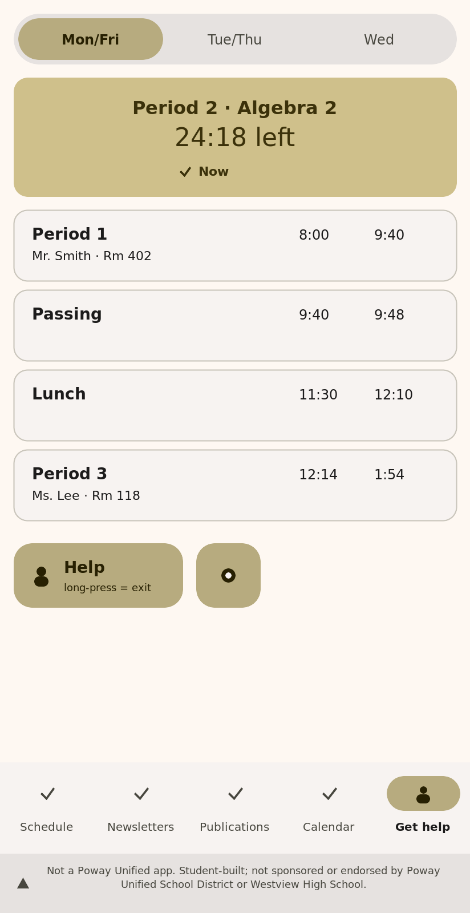
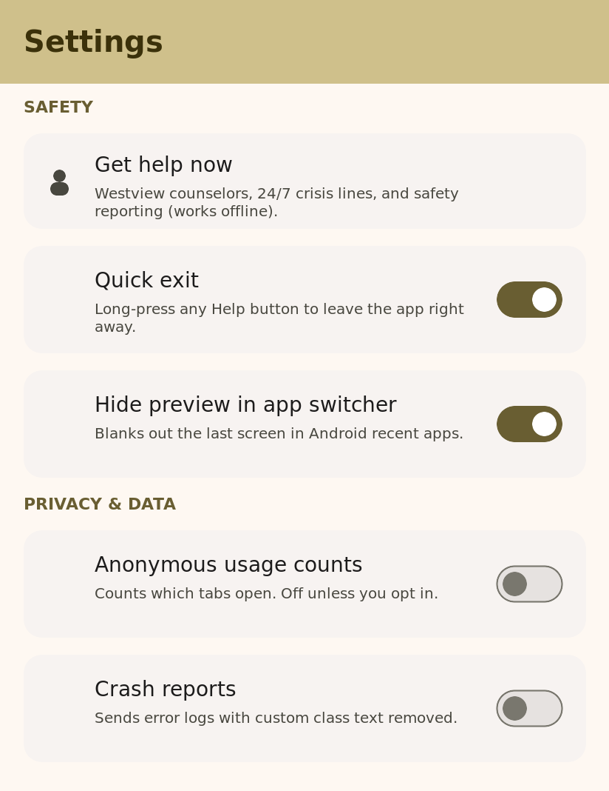
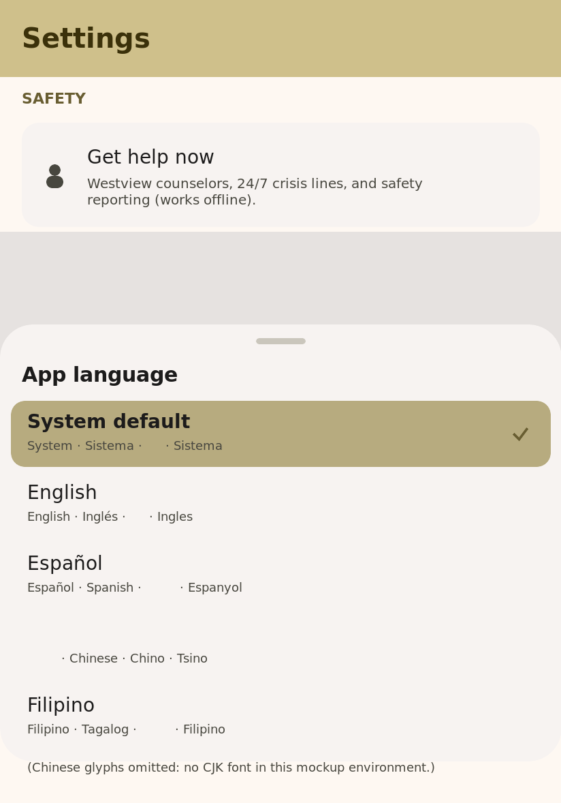

# Westview HS (WVAA)

I built WVAA as an Android-first Flutter app for students at Westview High School (Poway Unified School District) so I wouldn't have to jump between separate tabs and links just to check the bell schedule, calendars, newsletters, student publications, and the daily lunch menu. Alongside the in-app schedule, it also runs an ongoing countdown notification and a home-screen widget that track the current period and how much time is left.

> **This is not a Poway Unified app.** I built this independently as a student project, so it isn't sponsored or endorsed by Poway Unified School District or Westview High School, and nothing inside the app should be treated as an official school statement. See [Student safety](#student-safety) and [`docs/SAFETY.md`](docs/SAFETY.md) for the full details.

> I actively build and test this app for Android. The iOS target still compiles, but I don't actively maintain it.

## Features

- **Get help:** A permanent tab with Westview's school counselors (listed by last-name caseload with one-tap call and email), 24/7 crisis lines (988, San Diego Access & Crisis Line, Crisis Text Line, and the Trevor Project), anonymous reporting links, and 911. Because all of that contact info is bundled into the app, it works completely offline, and opening the tab is never logged.
- **Bell schedules:** Regular Mon/Fri, Tue/Thu, and Wednesday late-start schedules with a live per-second countdown to the end of the current period. You can rename any class period (for example, changing "Period 1" to "Human Body Systems") and add your teacher and room number.
- **Special schedules:** On early-release, assembly, or Link Crew days, the app fetches the modified schedule from the school server and overrides the regular bell schedule in the app, on the widget, and in the countdown notification. Responses stay cached for at least two days so the schedule still loads if the server goes down.
- **Live countdown notification:** An ongoing Android notification displays the current period, teacher/room, and a ticking `Chronometer`. On a locked phone, the notification stays hidden (`VISIBILITY_SECRET`) so strangers walking by can't read your class schedule; your class details only show up after you unlock the screen. It also reschedules itself across reboots through `AlarmManager`.
- **Home-screen widget:** The "Current Period" widget shows your active class, a live countdown, and what period comes next. Because `Chronometer` ticks inside the launcher process and `AlarmManager` only wakes the app at period transitions, the timer stays accurate without draining battery.
- **Calendars and lunch menu:** School and Athletics Google Calendars alongside the daily school lunch menu and nutrition facts.
- **Newsletters:** The weekly newsletter, counseling newsletters, and DEN announcements, each loaded inside an in-app WebView.
- **Publications:** The Westview Nexus student newspaper and Westview Newscast on Vimeo. If you leave the app while a Vimeo video is playing, it automatically switches into Android picture-in-picture mode instead of cutting off playback.
- **Light and dark themes:** Material 3 light and dark palettes built from Westview's gold and brass colors, following your phone's system theme while keeping every text and surface pair above WCAG AA contrast minimums.
- **Offline fallbacks for bad campus Wi-Fi:** Campus Wi-Fi drops pretty often in certain buildings, so calendars, lunch menus, and special schedules save their last good response on the device and show a "saved copy" banner when a refresh fails. Newsletter and publication WebViews also keep an already-loaded page on screen rather than replacing it with an error screen mid-session.
- **Manual refresh everywhere:** Pull-to-refresh on calendars and lunch menus, a refresh button in the header on newsletters and publications, and retry buttons whenever an initial load fails.
- **Languages and accessibility:** Full app translations in English, Spanish, Simplified Chinese, and Filipino, including all crisis and safety text. Controls carry explicit screen-reader labels (for example, the 911 button announces as "9 1 1"), tap targets are at least 48dp (56dp on the 911 button), text scales up to 200% without clipping, status never relies on color alone, notifications stay silent, and every crisis line includes a text or chat option alongside calling. See [`docs/ACCESSIBILITY.md`](docs/ACCESSIBILITY.md).
- **Opt-in anonymous diagnostics:** Optional usage counts and crash reports stay off until you choose to turn them on, with separate switches for each and automatic redaction for anything you typed into your schedule. See [Privacy](#privacy).
- **Quick exit and app-switcher privacy:** Holding down any Help button sends the app straight to the background, and Android's app switcher blanks out the app preview by default so nobody looking over your shoulder can see what tab you had open.

## Why It Uses Plain Material 3

Since Android is the only platform I actively support, I used Material 3 components across the whole app (`NavigationBar`, `SegmentedButton`, Material switches, and bottom sheets) rather than trying to maintain separate adaptive widgets for iOS. The one exception is in `lib/publications.dart`, where I kept a small WebKit check for inline video playback so the iOS build still compiles cleanly.

## Privacy

If you opt in, the app can send two kinds of anonymous data, and nothing else:

- **Anonymous usage counts:** Which tabs get opened and whether content refreshes succeed or fail.
- **Crash reports:** The error message and a shortened stack trace when an unhandled exception happens.

Both switches start turned **off**. Nothing gets queued or sent unless you tap "Share anonymously" on the first-launch prompt or turn the switches on yourself in **Settings > Privacy**. If you turn either switch off later, the app clears any unsent items from storage right away instead of flushing them on the next launch.

The app doesn't use any third-party analytics or crash SDKs, and it never collects your name, student ID, accounts, contacts, location, or device/advertising IDs. Reports only go to `studycs.org` (the same server that hosts the special-schedule files), and the client scrubs them before they ever hit disk:

- Anything you typed under "My classes" (course names, teacher names, and room numbers) gets replaced with `[text]`.
- Anything matching an email address or phone number gets replaced with `[email]` or `[phone]`.
- The only identifier attached to a batch is a random session ID generated in memory each time the app starts.

Opening the **Get help** tab is never logged at all, even if usage analytics are turned on.

Saved calendar events, lunch menus, and nutrition facts stay locally on your phone, and you can clear all of them anytime from **Settings > Saved content**.

## Student safety

I wrote out the full reasoning, contact sources, and verification dates in [`docs/SAFETY.md`](docs/SAFETY.md), so here is the main summary:

- **Get help is always reachable in one tap:** It sits permanently in the bottom navigation bar, in the top corner of the other tabs, and at the top of Settings. Because all counselor contacts, crisis hotlines, and 911 actions are compiled directly into the app, the screen still works with zero signal.
- **Contact numbers are verified and locked down by tests:** Counselor caseloads, phone extensions, and email addresses come from Westview's counseling page (verified November 2025), and `test/support_resources_test.dart` checks every hotline number and URI directly so an accidental edit can't ship a broken number.
- **The Poway Unified disclaimer stays visible:** The required district disclaimer (in both English and Spanish) is shown in full on the Get help screen and in Settings, while a short version stays pinned above the bottom navigation bar on every tab.
- **Your schedule stays off the lock screen:** The countdown notification channel uses `VISIBILITY_SECRET`, which hides the notification until you unlock your phone. Even its fallback public version only includes the period label and leaves out custom class names, teachers, and room numbers.
- **Quick exit and hidden app-switcher previews default to on:** Long-pressing any Help icon backgrounds the app immediately without asking "Are you sure?", and the Android recents thumbnail is blanked out while the app is backgrounded. Both toggles live under **Settings > Safety**.
- **Minimal permissions:** I removed `USE_FULL_SCREEN_INTENT` and set `showWhenLocked="false"` so a schedule timer can never pop up over a locked screen or interrupt another app. The app only asks for internet, notifications, and the alarm/boot permissions needed to update the widget.

## Language and accessibility

Every screen I draw in the app ships in **English, Spanish, Simplified Chinese, and Filipino**. You can switch languages under `Settings > Safety > Language · Idioma · 语言 · Wika`, where the row title includes all four languages so you can still find it if the phone is set to a language you don't read, or leave it on **System default** to follow Android.

None of the safety copy is machine-translated at runtime. Every string lives in `lib/l10n/strings.dart`, including the 911 card, all six crisis lines, counselor roles, reporting notes, and the district disclaimer, and is checked by `test/l10n_test.dart` and `tools/check_strings.py`. Those checks fail if any language misses a key, leaves a safety string identical to English, or looks up a key in Dart that isn't in the string catalog. If a key were ever missing at runtime, it falls back to English and then to the raw key name so mistakes show up immediately during testing rather than rendering an empty button.

On Android, launcher and widget descriptions are also translated in `res/values-*/strings.xml`, and `res/xml/locale_config.xml` hooks into the Android 13+ per-app language picker in system settings.

For more detail on screen readers, colorblind contrast checks, reduced motion, deaf/hard-of-hearing crisis options, text scaling, and current limitations, see [`docs/ACCESSIBILITY.md`](docs/ACCESSIBILITY.md). For device, maintenance, and administrative edge cases, see [`docs/COMPATIBILITY.md`](docs/COMPATIBILITY.md).

## Screenshots

These mockups are generated from the real color tokens in `lib/theme/colors.dart` and the actual app copy using `python3 tools/render_mockups.py`. Because the script renders them with ImageMagick instead of a live Flutter emulator, the spacing isn't pixel-identical to a phone screenshot, though all colors and strings match what ships in the app.

| | |
| --- | --- |
|  |  |
| Emergency card and counselor roster | Crisis lines, reporting links, and disclaimer |
|  |  |
| Help button and pinned disclaimer bar | Settings > Safety, including Language |
|  |  |
| Get help screen in Spanish | Language picker (CJK characters omitted because the mockup script runs without a CJK font) |
|  |  |
| Get help simulated under deuteranopia | App color palette across all four vision types |

## Project layout

```
lib/
  main.dart              App entry point, Material 3 navigation shell, crash
                         reporting setup, and first-run privacy prompt
  data.dart              Regular bell schedules (Mon/Fri, Tue/Thu, Wed)
  schedule_page.dart     Schedule tab, live countdown, and settings button
  special_schedule.dart  Special-schedule fetcher and multi-day cache
  settings.dart          Saved user settings and privacy consent state
  settings_page.dart     Settings screen (safety, notifications, privacy, classes)
  telemetry.dart         Opt-in anonymous crash reports and usage counts
  support.dart           Get help screen: counselors, crisis lines, disclaimer
  l10n/strings.dart      Translations for en/es/zh/tl and AppLanguage logic
  safety.dart            Quick exit and app-switcher privacy channel
  network_cache.dart     Local cache for calendars, menus, and nutrition data
  widget_sync.dart       Syncs schedules and class names to the Android widget
  calendars.dart         Calendar tabs (School, Athletics, Lunches)
  school_lunch.dart      Daily lunch menu and nutrition facts sheet
  newsletter_page.dart   Newsletter WebView tabs
  publications.dart      Publications WebViews and Vimeo PiP handling
  vimeo_pip.dart         Injected JS bridge between Vimeo's player and Android PiP
  web_page.dart          Shared WebView wrapper with loading/error/retry UI
  theme/                 Color tokens and light/dark Material 3 themes
  widgets/
    section_selector.dart  Material 3 pill selector and lazy keep-alive stack
    status_views.dart      Shared loading, empty, error, and saved-copy views

docs/
  SAFETY.md              Safety design notes, contact sources, and disclaimers
  ACCESSIBILITY.md       Translations, screen readers, contrast, and motion notes
  COMPATIBILITY.md       Device, maintenance, and school-policy compatibility notes

tools/
  audit_contrast.py      WCAG contrast and colorblind separation checker
  check_strings.py       Verifies lib/l10n/strings.dart formatting and key parity
  render_mockups.py      Renders docs/screenshots/ from app colors and copy
  annotate_ci.py         Formats Flutter test/analyze/build failures for GitHub CI

android/app/src/main/kotlin/com/westviewhs/app/
  MainActivity.kt                    Flutter activity, PiP hooks, and safety channel
  CustomLiveActivityManager.kt       Custom notification layout for live activities
  ScheduleNotificationManager.kt     Ongoing countdown notification and channel setup
  ScheduleWidgetProvider.kt          Home-screen widget provider
  ScheduleWidgetRenderer.kt          Widget rendering and AlarmManager scheduling
  ScheduleWidgetAlarmReceiver.kt     Broadcast receiver for period transitions
```

## Special schedules

When Westview runs a modified bell schedule (like early release, Link Crew, or an assembly), the app swaps out the regular weekday periods for the schedule returned by the server and shows a dismissible banner letting you know a special schedule is active today.

```
GET https://studycs.org/westview/special_schedule2/{month}/{day}
```

- If the server returns `HTTP 200` with a body containing `.json`, the app fetches `https://studycs.org/<path>` and parses its JSON list of `{hour, minute, duration, title, isPM}` period entries.
- If the server returns `HTTP 200` with an empty body (or text without `.json`), there's no special schedule for that date, so the app uses the normal weekday schedule.

### Caching

Whether a date has a special schedule or not, the app caches the result on the device for **at least two days** (three days in storage to leave some buffer). Because of that cache window, the app won't hit the server more than once per date, which keeps everyone opening the app before first period from overloading the server at the same time. If the server can't be reached at all, the app keeps using the last saved answer and puts up a warning banner saying today's schedule might be out of date. Everything is stored in `SharedPreferences`, so it stays intact across app restarts.

### Backup sources

If `studycs.org` goes down, `SpecialScheduleService` can walk through backup URLs in `fallbackUrls` (which is empty by default). You can point a fallback URL at any static file host, such as a public Google Drive direct-download link, with optional `{month}` and `{day}` placeholders:

```dart
fallbackUrls.add(
  'https://drive.google.com/uc?export=download&id=YOUR_PUBLIC_FILE_ID',
);
```

## Home-screen widget (Android)

To add the widget on Android, long-press your home screen, tap **Widgets**, find **Westview HS**, and drag **Current Period** onto your home screen.

- Inside the widget, Android's native `Chronometer` view ticks every second inside the home launcher process, so the app doesn't have to wake up every second just to update the clock.
- `AlarmManager` schedules an exact wakeup right when each period starts or ends (alongside listeners for reboot, time, time zone, and date changes), which keeps the widget accurate even if you haven't opened the main app in days.
- Whenever you edit class names or load a special schedule in Flutter, `widget_sync.dart` pushes the updated list to native `SharedPreferences` through `home_widget`. Before the Flutter app has run for the first time, the widget falls back to built-in default schedules matching `lib/data.dart`.

## Settings

Tapping the gear button in the bottom-right corner of the Schedule tab opens Settings:

- **Safety:** Quick access to Get help, toggles for quick exit and hiding the app-switcher preview, and the **Language** picker (System default, English, Español, 简体中文, and Filipino).
- **Notifications:** The main notification switch; turning this off stops the app from posting any notifications at all.
- **Live activity:** Controls the ongoing period countdown notification (only active when Notifications are also turned on).
- **Show teacher / Show room number:** Controls whether teacher names and room numbers appear on the schedule tab, the countdown notification, and the home-screen widget.
- **My classes:** Lets you rename Period 1 through Period 4 and fill in your teacher and room number for each class.
- **Privacy and saved content:** Separate opt-in switches for anonymous usage stats and crash reports, plus a button to clear cached calendars and lunch menus.
- **About this app:** Shows the full Poway Unified disclaimer in English and Spanish, explains that the app is student-built, and reminds users that the app itself isn't a monitored crisis service.

Changes save right away and sync immediately to the schedule tab, notification, and widget.

## Lock-screen notifications

I set up the live countdown as a silent, ongoing notification on a channel with `IMPORTANCE_LOW` and `VISIBILITY_SECRET`. Because the channel visibility is `SECRET`, Android hides the notification on a locked screen instead of putting your period, teacher, or room number where anyone nearby could see it; those details only appear once you unlock your phone. I also attached a stripped-down public version that only shows the period name, so even if someone loosens the lock-screen setting in Android's system settings, teacher and room info still won't show up on a locked screen. Tapping the notification opens the app normally after unlock, since `MainActivity` sets `showWhenLocked="false"` and doesn't carry `USE_FULL_SCREEN_INTENT`.

On Android 13 and newer, the app asks for `POST_NOTIFICATIONS` on first launch if live activities are enabled. If you deny that permission, everything else keeps working normally, including the schedule tab, the home-screen widget, and Get help.

If you'd rather hide your teacher or room number everywhere, even when your phone is unlocked, turning off **Show teacher** or **Show room number** in Settings removes them from the schedule list, notification, and widget at the same time.

## Building

### Local APK (for sideloading)

```sh
flutter pub get
flutter build apk --release
```

This writes `build/app/outputs/flutter-apk/app-release.apk`, signed with the debug keystore so you can install it directly on an Android phone.

### Google Play signing

If you want to publish a build to Google Play, set up a real upload keystore following the [Flutter Android signing guide](https://docs.flutter.dev/deployment/android#signing-the-app), create `android/key.properties`, and update `release.signingConfig` in `android/app/build.gradle.kts`.

### GitHub Actions

`.github/workflows/build-apk.yml` runs on pushes and pull requests to `main` (plus manual `workflow_dispatch` runs), builds a release APK, and uploads it as a 30-day workflow artifact. Pushing a `vX.Y.Z` tag also creates a GitHub Release with the APK attached. In CI, `versionCode` uses `GITHUB_RUN_NUMBER` so every new build gets a higher version number automatically.

## Architecture notes

- **State management:** `AppSettings` and `SpecialScheduleService` are `ChangeNotifier` singletons, and screens rebuild from them using `ListenableBuilder` or listener hooks in `initState` and `dispose`.
- **Countdown timer:** One 1-second `Timer.periodic` in `SchedulePage` handles the on-screen countdown, midnight date rollovers, and syncing updates to the widget, while the rest of the app updates only when events happen.
- **Networking:** `SpecialScheduleService` takes an injected `http.Client` (which makes mocking responses in tests straightforward) with a 10-second timeout, and failed requests fall back to cached data instead of crashing the screen.
- **Vimeo picture-in-picture:** `vimeo_pip.dart` injects a small JavaScript bridge into the Publications WebView so it can watch playback events through Vimeo's `postMessage` API. When you background the app during playback, the Flutter shell hides its own headers and navigation bar so the video fills the entire activity window before Android shrinks it into PiP.
- **Package ID:** The Android `applicationId` and namespace are both `com.westviewhs.app`.

## Tests

```sh
flutter test
```

The test suite checks schedule period transitions, settings storage, special-schedule parsing and multi-day caching (with `MockClient`), Vimeo URL matching, crisis hotline and counselor contact numbers, and localization/accessibility rules in `test/l10n_test.dart` (making sure all four languages have matching keys, safety strings are actually translated, every key used in `lib/` exists, the Get help screen lays out cleanly at 200% font scale in every language, and the 911 button exposes the `"9 1 1"` screen-reader label).

Before building the APK, CI also runs two Python checks:

```sh
python3 tools/check_strings.py
python3 tools/audit_contrast.py --strict
```

`check_strings.py` verifies `lib/l10n/strings.dart` formatting and key parity, while `audit_contrast.py --strict` fails the build if any light or dark color pair drops below WCAG AA contrast or if the active-period highlight becomes hard to tell apart under deuteranopia, protanopia, or tritanopia.
