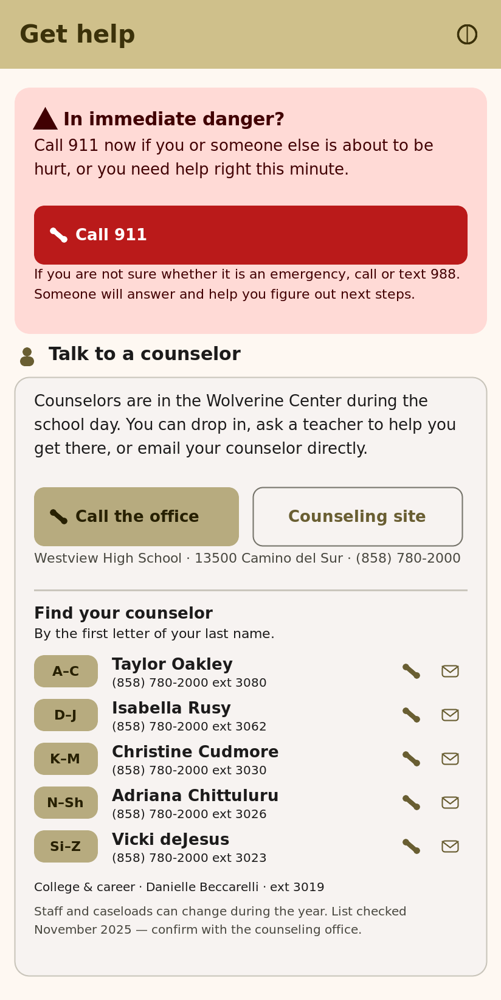
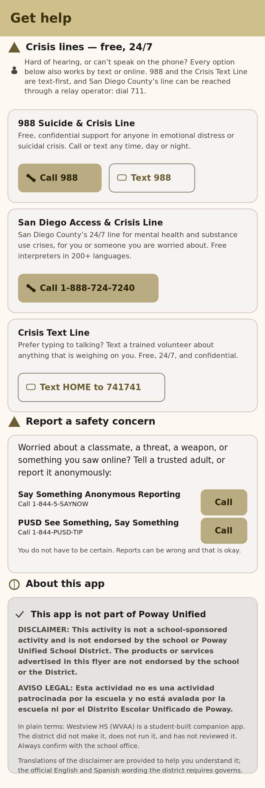
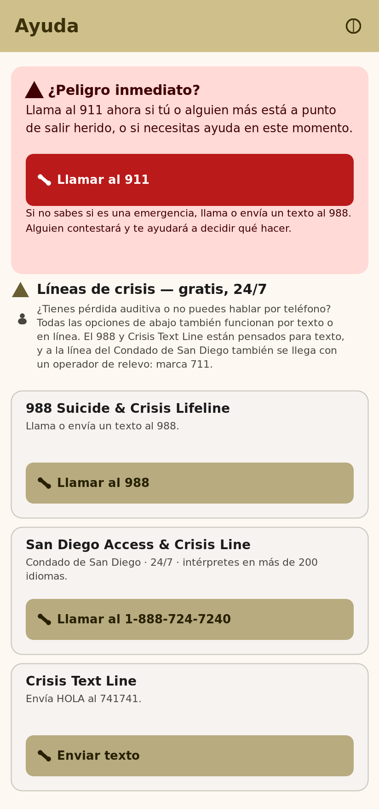
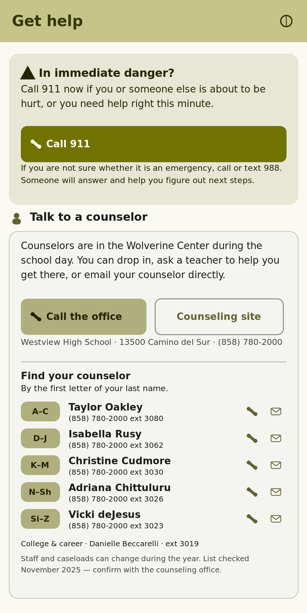
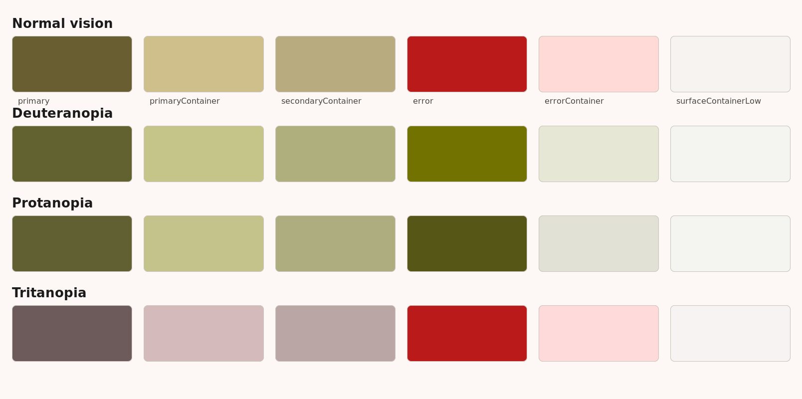

# Westview HS (WVAA)

A companion app for Westview High School (Poway Unified School District), built with Flutter. The app brings together the schedules, calendars, newsletters, student publications, and lunch menu that students use every day, plus a live countdown notification and a home-screen widget that shows the current class period.

> **This is not a Poway Unified app.** It is a student-built project. It is not
> sponsored or endorsed by Poway Unified School District or Westview High
> School, and nothing in it should be treated as an official school statement.
> See [Student safety](#student-safety) and [`docs/SAFETY.md`](docs/SAFETY.md).

> The app is optimized for Android (the primary target). iOS support compiles but is not actively maintained.

## Features

- **Get help** — a permanent tab with the school counselors (by last-name
  caseload, with one-tap call and e-mail), 24/7 crisis lines (988, San Diego
  Access & Crisis Line, Crisis Text Line, Trevor Project), anonymous reporting
  routes, and 911. Works fully offline; opening it is never logged.
- **Schedules** — Mon/Fri, Tue/Thu, and Wednesday late-start schedules with a live per-second countdown to the end of the current period. Any period can be renamed (e.g. "Human Body Systems" instead of "Period 1") with teacher and room number.
- **Special (modified) schedules** — Early-release, assembly, and Link-Crew days are fetched from the school server and override the regular schedule in-app, on the widget, and in the ongoing notification. Results are cached for at least two days so the app still works when the server is unreachable.
- **Live countdown notification** — An ongoing Android notification shows the current period, teacher/room, and a ticking Chronometer. On the lock screen it shows the period name only (visibility `SECRET`); teacher and room appear once the phone is unlocked. It survives reboots via AlarmManager.
- **Home-screen widget** — "Current Period" widget shows the active class, a live countdown, and a one-liner about what's next. It self-updates at period boundaries with precise alarms and uses a Chronometer so it ticks without waking the device.
- **Calendars** — School and Athletics Google Calendars, plus the daily school lunch menu with nutrition-fact details.
- **Newsletters** — Weekly newsletter, counseling newsletters, and DEN announcements, each in an embedded WebView.
- **Publications** — Westview Nexus (student newspaper) and Westview Newscast (Vimeo). Vimeo videos automatically enter Android picture-in-picture when you leave the app mid-playback.
- **Theming** — Material 3 light and dark themes that follow the system setting, built from the school's gold/brass palette with WCAG-AA-checked contrast pairs.
- **Works on bad Wi-Fi** — Calendars, lunch menus and special schedules cache their last-known content on disk and keep showing it (with a "saved copy" notice) whenever the school network is down. Newsletter/publication WebViews keep their loaded pages and never blank out mid-session.
- **Refresh everywhere** — Pull-to-refresh on calendars and lunch menus; a refresh button on newsletters and publications; retry buttons on every error screen.
- **Accessibility** — Four languages (English, Spanish, Simplified Chinese, Filipino) covering every screen the app draws, including all crisis resources; screen-reader semantics on every control (the 911 button is read as "9 1 1"); 48dp minimum tap targets (56dp for the emergency action); font scaling honoured to 200 % with no clipped text; status never conveyed by colour alone; silent notifications; a text-first route for every crisis line. Details in [`docs/ACCESSIBILITY.md`](docs/ACCESSIBILITY.md).
- **Privacy-first telemetry** — Anonymous crash reports and usage counts, **off until you opt in**, with per-stream switch and automatic scrubbing of anything you typed. See [Privacy](#privacy) below.
- **Safety controls** — quick exit from a long-press, and the app's last screen hidden in the Android app switcher. Class details are never shown on the lock screen.

## Material 3, Android-first

Android is the only actively supported target, so the UI is plain Material 3 throughout — `NavigationBar`, `SegmentedButton`, Material switches, bottom sheets — instead of cross-platform adaptive widgets. The one deliberate exception is the Publications WebView, which keeps a small platform branch for iOS inline-video playback so the project keeps compiling there.

## Privacy

The app can collect two things, both anonymous, and nothing else:

- **Anonymous usage statistics** — counts of which screens are opened and whether refreshes succeeded.
- **Crash reports** — the error text and a truncated stack trace, when something breaks.

Both are **opt-in**. They start disabled, and nothing is queued or sent until the first-run dialog is answered with "Share anonymously" (or the matching switch is turned on in **Settings ▸ Privacy**). Turning a stream off later drops its queued reports instead of sending them.

It never collects names, student IDs, accounts, contacts, location, or advertising/device identifiers, and it uses no third-party analytics or crash SDKs. Reports go only to the school's own server (`studycs.org`, the same host as the special-schedule data), and are scrubbed first:

- anything typed into "My classes" (class names, teacher names, room numbers) is replaced with `[text]`,
- anything that looks like an e-mail address or phone number is replaced with `[email]` / `[phone]`,
- the only identifier is a session id regenerated on every launch.

Opening the **Get help** tab is never recorded, by design.

Cached content (calendars, menus, nutrition data) stays on the device and can be wiped from **Settings ▸ Saved content**.

## Student safety

Full detail (data sources, verification dates, and the reasoning behind each
decision) is in [`docs/SAFETY.md`](docs/SAFETY.md). The short version:

- **Get help is always one tap away** — a navigation tab, a Help button on the
  schedule screen, and a Settings entry. Counselors, crisis lines and 911 are
  compiled into the app, so the screen works with no network at all.
- **Contacts are verified and pinned by tests.** Counselor caseloads, extensions
  and e-mails come from the school's counseling page (checked November 2025);
  every hotline number is asserted in `test/support_resources_test.dart` so a
  typo cannot ship.
- **The district disclaimer is permanent.** The exact Poway Unified wording
  ("This activity is not a school-sponsored activity and is not endorsed by the
  school or Poway Unified School District…") plus its Spanish version appears
  on the Get-help screen and in Settings, and a one-line version is pinned
  under the navigation bar on every tab.
- **Nothing about the schedule appears on a locked phone.** The countdown
  notification's channel visibility is `SECRET`, and its redacted "public"
  version (used if visibility is ever loosened) carries the period name only —
  never the course name, teacher or room.
- **Quick exit** (long-press any Help button) and **hide in app switcher** are
  both on by default and can be turned off in **Settings ▸ Safety**. Quick exit
  works from every tab, since the Help icon is in each tab's header.
- The app has no full-screen-intent permission, does not show itself over the
  lock screen, and requests no permissions beyond internet, notifications and
  what the home-screen widget needs.

## Language and accessibility

The app ships complete copy in **English, Spanish, Simplified Chinese and
Filipino**. `Settings ▸ Safety ▸ Language · Idioma · 语言 · Wika` picks a language;
each option is labelled in all four languages so it is findable from any starting
point, and **System default** follows the phone.

Safety copy is never machine-translated at runtime: every string — the 911 card,
all six crisis lines, the counselor roster, the reporting guidance, the district
disclaimer — is in `lib/l10n/strings.dart` and checked by `test/l10n_test.dart`,
which fails if any language is missing a key, leaves a safety string in English,
or references a key that does not exist. A missing key falls back to English and
then to the key name, so a typo shows up in tests instead of as a blank label.

Android also gets translated launcher/widget labels and the Android 13+ per-app
language picker (`res/xml/locale_config.xml`).

Full accessibility posture — screen readers, colour-blind safety, reduced motion,
deaf/HoH routes, text scaling, and the known gaps — is in
[`docs/ACCESSIBILITY.md`](docs/ACCESSIBILITY.md). Compatibility risks from a
student, developer and administrator point of view are in
[`docs/COMPATIBILITY.md`](docs/COMPATIBILITY.md).

## Screenshots

Layout mockups rendered from the app's real colour tokens
(`lib/theme/colors.dart`) and real copy by `python3 tools/render_mockups.py`.
They are not pixel-exact device screenshots — there is no Flutter SDK in the
environment that renders them — but every colour and string shown is the one the
app ships.

| | |
| --- | --- |
|  |  |
| Emergency card and counselor roster | Crisis lines, reporting routes, disclaimer |
|  |  |
| Help button + pinned disclaimer bar | Settings ▸ Safety, including Language |
|  |  |
| The same screen in Spanish | Language picker (CJK glyphs omitted: no CJK font in the mockup environment) |
|  |  |
| Get help under deuteranopia | Brand palette under all four vision types |

## Project layout

```
lib/
  main.dart              App entry point, Material 3 navigation shell, crash
                         reporting bootstrap, first-run privacy dialog
  data.dart              Bell schedules (Mon/Fri, Tue/Thu, Wed)
  schedule_page.dart     Home/Schedule tab, live countdown, settings FAB
  special_schedule.dart  Special-schedule fetch + multi-day cache
  settings.dart          Persisted user settings incl. telemetry consent
  settings_page.dart     Settings UI (notifications, privacy, classes)
  telemetry.dart         Anonymous crash reporting + analytics (opt-in, scrubbed)
  support.dart           Get-help screen: counselors, crisis lines, disclaimer
  l10n/strings.dart      String catalogue for en/es/zh/tl + AppLanguage
  safety.dart            Quick exit + recents privacy
  network_cache.dart     Last-known-good disk cache for network content
  widget_sync.dart       Pushes schedules/settings to the Android widget
  calendars.dart         Calendar tabs (School, Athletics, Lunches)
  school_lunch.dart      Lunch menu + nutrition facts (cache-first)
  newsletter_page.dart   Newsletter tabs
  publications.dart      Publications tabs + Vimeo PiP handling
  vimeo_pip.dart         Vimeo player <-> PiP bridge (injected JS)
  web_page.dart          Shared WebView wrapper (loading/error/retry states)
  theme/                 App color tokens + light/dark Material 3 ThemeData
docs/SAFETY.md           Student-safety and developer-safety design notes
docs/ACCESSIBILITY.md    Languages, screen readers, colour, deaf/HoH, motion
docs/COMPATIBILITY.md    Student/developer/administrator risk review
tools/audit_contrast.py  WCAG contrast + colour-blind simulation checker
tools/render_mockups.py  Renders docs/screenshots/ from the real tokens/copy
  widgets/
    section_selector.dart  Material 3 pill tabs + lazy keep-alive stack
    status_views.dart      Shared loading / empty / error / saved-copy states

android/app/src/main/kotlin/com/westviewhs/app/
  MainActivity.kt                    Flutter activity, PiP callbacks, channel init
  CustomLiveActivityManager.kt       Custom notification UI for the live activity
  ScheduleNotificationManager.kt     Ongoing countdown notification + channel
  ScheduleWidgetProvider.kt          Home-screen widget provider
  ScheduleWidgetRenderer.kt          Widget rendering + AlarmManager scheduling
  ScheduleWidgetAlarmReceiver.kt     Broadcast receiver for period ticks
```

## Special (modified) schedules

On days with a special schedule (early release, Link Crew, assemblies, …) the app replaces the regular weekday schedule with the one returned by the school's server and shows a dismissable "A special schedule is in effect today" banner.

```
GET https://studycs.org/westview/special_schedule2/{month}/{day}
```

- `HTTP 200` with a plain-text body containing `.json` → the app downloads `https://studycs.org/<path>` and parses it as a JSON list of `{hour, minute, duration, title, isPM}` entries.
- `HTTP 200` with an empty body (or any body without `.json`) → no special schedule that day; the regular schedule is shown.

### Caching

Every answer (schedule or "none") is cached on device for **at least 2 days** (3 to leave headroom). The server is never asked more than once per date inside that window, so the app doesn't contribute to load spikes. If the server cannot be reached the last known answer — even a stale one — is still used, and a banner warns that "today's schedule may not be accurate". The cache survives app restarts via SharedPreferences.

### Backup sources

If the primary server is down, the app tries each URL in `fallbackUrls` (empty by default). A backup URL can point at a static host (e.g. a public Google Drive direct-download link) and may use `{month}`/`{day}` placeholders.

```dart
fallbackUrls.add(
  'https://drive.google.com/uc?export=download&id=YOUR_PUBLIC_FILE_ID',
);
```

## Home-screen widget (Android)

Add the widget by long-pressing the home screen → Widgets → Westview HS → drag "Current Period" onto the home screen.

- The widget shows the current period and a Chronometer that counts down every second in the launcher process, so no wakeups are needed just to tick the timer.
- Precise `AlarmManager` wakeups are scheduled for each period transition, plus boot/time/timezone/date change broadcasts, so the widget stays correct even when the app hasn't been opened in a while.
- The Flutter app pushes schedules (including any special schedule and custom class/teacher/room names) via the `home_widget` plugin. Until the app runs once, built-in defaults (matching `lib/data.dart`) are used.

## Settings

A settings button in the bottom-right of the home screen opens:

- **Safety** — Get help now, quick exit, hide preview in app switcher, and
  **Language** (System default, English, Español, 简体中文, Filipino).

- **Notifications** — master switch; when off the app posts no notifications at all.
- **Live activity** — ongoing countdown notification (only runs while notifications are enabled).
- **Show teacher / Show room number** — whether teacher/room show up in the schedule list, notification, and widget.
- **My classes** — rename any period and enter teacher / room number.
- **About this app** — the district disclaimer (English + Spanish), what the
  app is not, and the "not a crisis service" notice.

All settings are persisted immediately and applied across the schedule, notification, and widget.

## Lock-screen notifications

The live countdown notification is posted as an ongoing, silent status notification on a channel with `IMPORTANCE_LOW` and `VISIBILITY_SECRET`. Secret means the notification is hidden from the lock screen entirely — no period name, course name, teacher or room — and only appears once the phone is unlocked. (The notification also carries a separate "public version" that shows the period name alone, so even if the channel's visibility is ever loosened, teacher and room still never appear.) Tapping it opens the app (never over the lock screen: the activity is `showWhenLocked="false"` and the app holds no `USE_FULL_SCREEN_INTENT` permission).

On Android 13+ the app asks for `POST_NOTIFICATIONS` on first launch (only when live activities are enabled, which is the default). Declining it breaks nothing: the schedule, widget and Get-help tab all keep working.

Students who want class details hidden everywhere can turn off **Show teacher** / **Show room number** in Settings; those switches apply to the schedule, the notification and the widget.

## Building

### Local (release APK, sideload)

```sh
flutter pub get
flutter build apk --release
```

Output: `build/app/outputs/flutter-apk/app-release.apk` (signed with the debug keystore — fine for sideloading).

### Google Play

Configure a real signing keystore per the [Flutter signing guide](https://docs.flutter.dev/deployment/android#signing-the-app), then generate `android/key.properties` and point `release.signingConfig` at it.

### GitHub Actions

`.github/workflows/build-apk.yml` builds a release APK on every push to `main` and every pull request targeting `main`, and uploads it as a downloadable workflow artifact (kept for 30 days). Pushing a tag `vX.Y.Z` additionally creates a GitHub Release with the APK attached. The workflow also accepts `workflow_dispatch` for manual runs. `versionCode` is set to the GitHub Actions run number so builds are monotonically increasing.

## Architecture notes

- **State** — `AppSettings` and `SpecialScheduleService` are singletons extending `ChangeNotifier`; pages consume them via `ListenableBuilder` and add/remove listeners in `initState`/`dispose`.
- **Timer** — a single 1-second `Timer.periodic` in `SchedulePage` drives the countdown, widget sync, and midnight-rollover detection; all other state updates are event-driven.
- **Network** — HTTP calls go through a `http.Client` injected into `SpecialScheduleService` (for testability) with a 10-second timeout; failures never crash the UI.
- **PiP** — Vimeo playback is detected via a JS bridge injected into the WebView (`vimeo_pip.dart`) that talks to Vimeo's postMessage player API. When the app backgrounds mid-playback the Flutter shell hides its chrome so the player can fill the activity surface before Android captures it for picture-in-picture.
- **Package name** — Android application ID / namespace is `com.westviewhs.app`.

## Tests

```sh
flutter test
```

Tests cover schedule time math, settings persistence, the special-schedule parser
and caching behavior (using `MockClient`), Vimeo URL detection, the crisis-contact
data, and the localization/accessibility contract (`test/l10n_test.dart`: all four
catalogues in sync, no untranslated safety strings, every catalogue key that the
code looks up exists, the Help screen renders in every language at 200 % text
scale, and the 911 button announces "9 1 1").

CI additionally runs the contrast audit before building:

```sh
python3 tools/audit_contrast.py --strict
```

which fails the build if any theme pair drops below WCAG AA or if the palette
stops being distinguishable under deuteranopia, protanopia or tritanopia.

